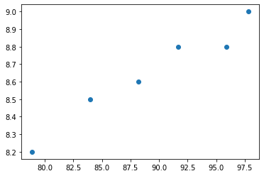
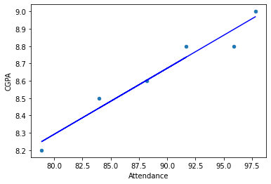

# Attendance and CGPA Regression

**Author:** Mohammed Adeen Shaik  
**Review date:** 11 October 2026

## Research question

What linear association appears in the six supplied semester observations?

## Data and provenance

Assessment/gradepred.xlsx, containing six semester records.

Source materials are linked from the repository README. Input fingerprints are recorded in [the evidence manifest](evidence.json) so a reader can identify the exact committed artifacts used in this review.

## Method and analytical rationale

An ordinary least squares line relates attendance percentage to CGPA. Coefficient, intercept and R-squared describe the fit to those same six observations.

## Findings and interpretation

The supplied workbook contains **six semester observations**. The original least-squares fit reports a slope of **0.03805779 CGPA per attendance percentage point**, an intercept of **5.24699972**, and **training R-squared 0.94951765**. These describe the six-point fit only; no independent test performance or causal attendance effect is established.

## Limitations

This is an instructional fit with no held-out evaluation. Six records cannot establish a reliable prediction service or causal effect of attendance on grades.

## Reproduction

Use the setup commands and input contract in the [repository README](https://github.com/Adeen1607/LINEAR_REGRESSION#readme). Open the [notebook catalogue](notebooks.html) for annotated code and saved outputs. Keep raw records and model binaries local; public reports contain aggregate results or source-embedded figures.

## Final visual results

*Figure from 452.LinearRegression.ipynb, original code cell 21.*

*Figure from 452.LinearRegression.ipynb, original code cell 41.*

